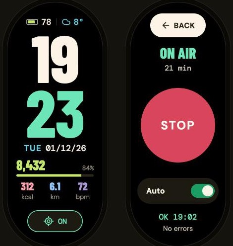

<h1 align="center">find-my-xiaomi-band-9</h1>

<p align="center">
  Turn a <b>Xiaomi Smart Band 9</b> into a <a href="https://en.wikipedia.org/wiki/Find_My">Find My</a> tracker — software only.<br>
  No soldering, no extra hardware. Just a custom watchface and your own Apple account.
</p>

<p align="center">
  
</p>

---

## What is this?

The Xiaomi Smart Band 9 has Bluetooth. This project ships a custom watchface that, besides showing the time, quietly broadcasts an [OpenHaystack](https://github.com/seemoo-lab/openhaystack)-style **Find My advertisement**. Apple devices that walk past your band anonymously report its location to Apple's network, and a small client on your Mac fetches and decrypts that location with **your own key**. You then see it on a map.

> **Not an official Apple accessory.** Your band does **not** show up in Apple's Find My app. Locations are retrieved separately. This is a hobby / reverse-engineering project — read [Risks](#risks) and [Safety](#safety) before using it.

## Platform support

| Step | Windows | macOS | Linux |
|---|:---:|:---:|:---:|
| Make your key, build the watchface, install via [AstroBox](https://astrobox.online/) | ✅ | ✅ | ✅ |
| **Fetch location from Apple** | ❌ | ✅ | ❌ |
| View location on a map (`viewer/index.html`) | ✅ | ✅ | ✅ |

**Fetching the location needs a Mac.** Apple only issues the fetch token to a native macOS "anisette" identity (as of 2026-10); emulating it elsewhere is experimental. Building and installing the watchface works everywhere.

> ⚠️ **Do not upgrade the fetching Mac to macOS 27.** It breaks the native anisette path the client needs. macOS 14–26 work.

---

## How to put it on your own band

> Keep your beacon key, Apple account and location **private**. The key file lives **outside** this repo and is never committed. `.gitignore` already excludes your personalized face and key.

### 0. Prerequisites

| Need | Windows | macOS | Linux |
|---|---|---|---|
| Xiaomi Smart Band 9 **Global, firmware 2.3.98** | required | required | required |
| Python 3.12+ | python.org | `brew install python@3.12` | distro package |
| JDK 21 (watchface packer) | Adoptium | `brew install openjdk@21` | distro package |
| [AstroBox](https://astrobox.online/) (installs the face on the band) | ✅ | ✅ | ✅ |

```sh
git clone https://github.com/muzafferkadir/find-my-xiaomi-band-9
cd find-my-xiaomi-band-9
python3 -m pip install cryptography
```

> The watchface refuses to run on any firmware other than 2.3.98 — the only tested target.

### 1. Create your own beacon key

A private key that identifies *your* tag. Generate it **outside** the repo and back it up; the generator refuses to overwrite an existing key.

```sh
python3 scripts/generate_key.py --out "$HOME/band9-keys.json"
```

### 2. Get your band's Bluetooth address

You need your band's Bluetooth MAC (`AA:BB:CC:DD:EE:FF`). Read it in the Mi Fitness app (device info) or from a BLE scanner while the band is paired. The watchface checks this on-device, so it must be *your* band.

### 3. Build your watchface

```sh
# Render a personalized watchface from the shared template (no secrets embedded)
python3 watchface/configure.py --keys "$HOME/band9-keys.json" --device-address 'AA:BB:CC:DD:EE:FF'

# Pack it into a .face file (downloads a pinned Java packer; needs JDK 21)
python3 watchface/build.py
```

### 4. Install it on the band

Open **AstroBox**, connect your band, and install `watchface/Band9FindMyV5.face`. Select the new face. It starts broadcasting automatically; tap **MENU** at the bottom for Find My (Start / Stop, Auto), Events and Agenda.

**Calendar.** Turn on *Events* in Mi Fitness and the band syncs your phone calendar into the stock Calendar app. The face reads that same data, shows the next event on the main screen and lists upcoming ones under Agenda. It can be hidden from MENU → Events.

> If AstroBox says *"Exceeded installed resource limit"*, the band is full — delete some old faces first.

## How to use it

### Fetch the location (on a Mac)

The client logs into **your own** Apple account on **your own** Mac, fetches the encrypted reports and decrypts them with your key. Email, password and 2FA are typed in your terminal and never stored in the repo.

```sh
cd report-client
python3 -m venv .venv
.venv/bin/pip install -r requirements.txt

# First run logs in and prints the location
.venv/bin/python fetch_location.py --keys "$HOME/band9-keys.json" --login

# Later runs reuse the saved session; --export saves a JSON you can plot however you like
.venv/bin/python fetch_location.py --keys "$HOME/band9-keys.json" --export "$HOME/band9-location.json"
```

If the band has been advertising and an Apple device passed near it, this prints the coordinates (and a Google Maps link). No report yet? Try again later — it depends on Apple devices nearby.

### See it on a map (any platform)

Open **`viewer/index.html`** in any browser and pick (or drag in) your `band9-location.json`. You get the location, an accuracy circle and how long ago it was seen. The map needs internet for tiles; your report file never leaves your machine.

---

## How it works (reverse-engineering summary)

The detailed firmware notes stay out of this repo; here is the gist.

**The band.** Xiaomi Smart Band 9 Global (`miwear.watch.n66gl`), firmware 2.3.98, runs NuttX/Vela with a Lua + LVGL UI on an ARM Cortex-M33. Watchfaces are Lua, which cannot touch the Bluetooth hardware directly — so the face runs a tiny native ARM Thumb bridge.

**Lua → native.** A long Lua string is kept alive and its memory address is found via `debug.upvalueid`. Native position-independent code is placed in that string, the data/instruction caches are synchronized in a strict order (D-cache clean → DSB/ISB → I-cache enable → DSB/ISB → verify bytes → execute), then a firmware helper jumps to it. Getting the cache order wrong makes the CPU run stale bytes; that was an early bug.

**The advertisement.** It's a standard OpenHaystack / Find My beacon:
- Generate a secp224r1 (P-224) private key; the public X coordinate (28 bytes) is the advertisement key.
- BLE random static address: `[X[0] | 0xc0] + X[1:6]`.
- 31-byte advertising data: `1e ff 4c 00 12 19 00` + `X[6:28]` (22 bytes) + `(X[0] >> 6)` + `00`.
- The **private key never goes on the band** — only the public payload does.

**The fetch.** Nearby iPhones encrypt the band's location with the public key and upload it to Apple. A Mac client (`report-client/`) logs in with your Apple ID, asks Apple for reports matching `SHA256(public key)`, and decrypts them locally with your private key. It uses the Mac's native AOSKit/AuthKit "anisette" identity because, since Oct 2026, Apple only issues the fetch token to that. Credit: the native-anisette provider is vendored from [dan-shah/findmy-wander-alert](https://github.com/dan-shah/findmy-wander-alert) (MIT, see `report-client/LICENSE.native-anisette`); fetching/decryption builds on [FindMy.py](https://github.com/malmeloo/FindMy.py).

---

## Limitations

- Only **Xiaomi Smart Band 9 Global, firmware 2.3.98** is supported.
- Not a certified Find My accessory; invisible in Apple's Find My app.
- Static beacon key, no rotation — fewer reports than a rotating AirTag, and Apple may de-duplicate repeats. Up to ~8 reports per key per fetch; a location can be minutes to an hour old.
- Fetching needs a Mac on macOS 14–26.
- Auto-start only when this custom face is loaded. Broadcasting while another face is selected, and resuming after reboot, is **not** solved.
- Occasional watch freezes were seen during development; stability on every firmware state is not guaranteed.

## Risks

Use this at your own risk.

- **Your band.** The watchface runs native code on the band and freezes have happened. In the worst case you may need to reinstall a face or re-pair. There is no warranty (see [LICENSE](LICENSE)).
- **Your Apple account.** The client uses private Apple frameworks and logs into your Apple ID in a way Apple does not officially support. This could, in principle, trigger security checks on your account. Use your own account and don't automate aggressive polling.
- **"Advertising started" ≠ delivered.** A successful Start on the band means the radio was asked to advertise; it does not guarantee Apple received a report.

## Safety

Tracking a person without their knowledge and consent is illegal in many places. Use this only on **your own** belongings. The static key means anyone who captures your advertisement can recognize your tag over time — don't publish your personalized face or key. Your Apple credentials and beacon key stay on your own machine; never commit them.

## License

[MIT](LICENSE). Bundled third-party code keeps its own notices (see `report-client/LICENSE.native-anisette`). Firmware images and reverse-engineering databases are **not** included.
